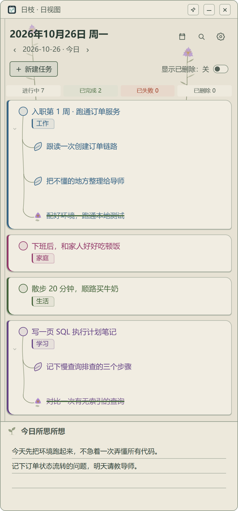
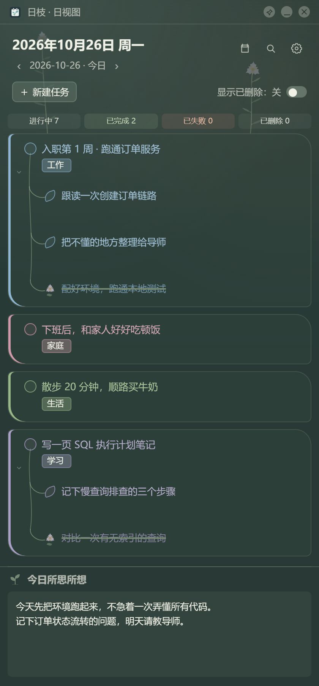
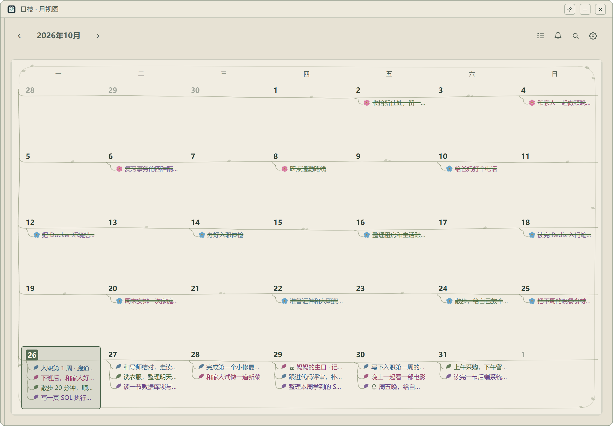
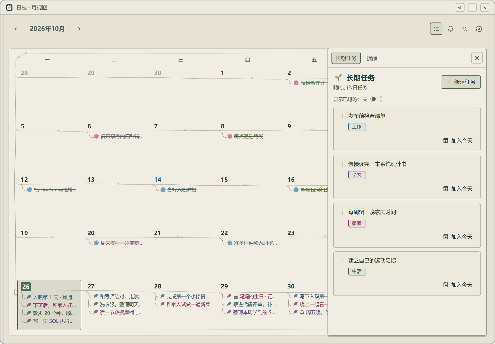

# 日枝 · FloraGrid

**让每一天，长出一点进展。**

想做一款安静留在桌面的小工具，把待办、日历和想法放在一起。以日期承载日常，以枝叶表达任务层次，让完成的小事开成花。工作之外，也给家庭、生活和学习留位置。

## 先照顾今天，再慢慢长大

把大事拆成小步，拖动调整顺序与层级；整棵任务树可以复制到另一天。完成时开花，收工时写一段随笔。

<table>
  <tr><th>纸页笔记本</th><th>毛玻璃</th></tr>
  <tr>
    <td></td>
    <td></td>
  </tr>
</table>

## 安排工作，也给生活留位置

月历看整月安排，全局搜索找回任务与随笔。公历、农历生日和周期提醒会按日期加入日任务。



## 把常做的事收好，随时开始

长期任务先收进库中，再加入今天或指定日期；每次安排都是独立记录。用分组标签整理不同生活领域。



无需账号，数据保存在本机。支持多窗口、窗口置顶、精简外观，以及设置中的完整备份、恢复与文件夹迁移。

<sub>以上均为真实项目页面截图，演示数据围绕一位刚入职的后端工程师虚构生成，不包含私人记录。提醒是日任务，不是应用退出后的闹钟通知。</sub>

## 使用与开发

Windows 10/11 x64。安装版运行 Setup，免安装版解压后运行 `FloraGrid.exe`；两者默认使用同一份用户数据，需要 WebView2 运行时。

```powershell
npm ci
npm run dev
```

[完整功能](docs/功能全览.md) · [备份与换电脑](docs/数据备份与迁移.md) · [开发、检查与打包](docs/开发与发行.md) · [外观设计](docs/日枝外观.md)
